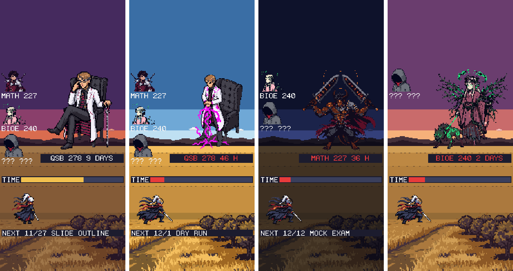
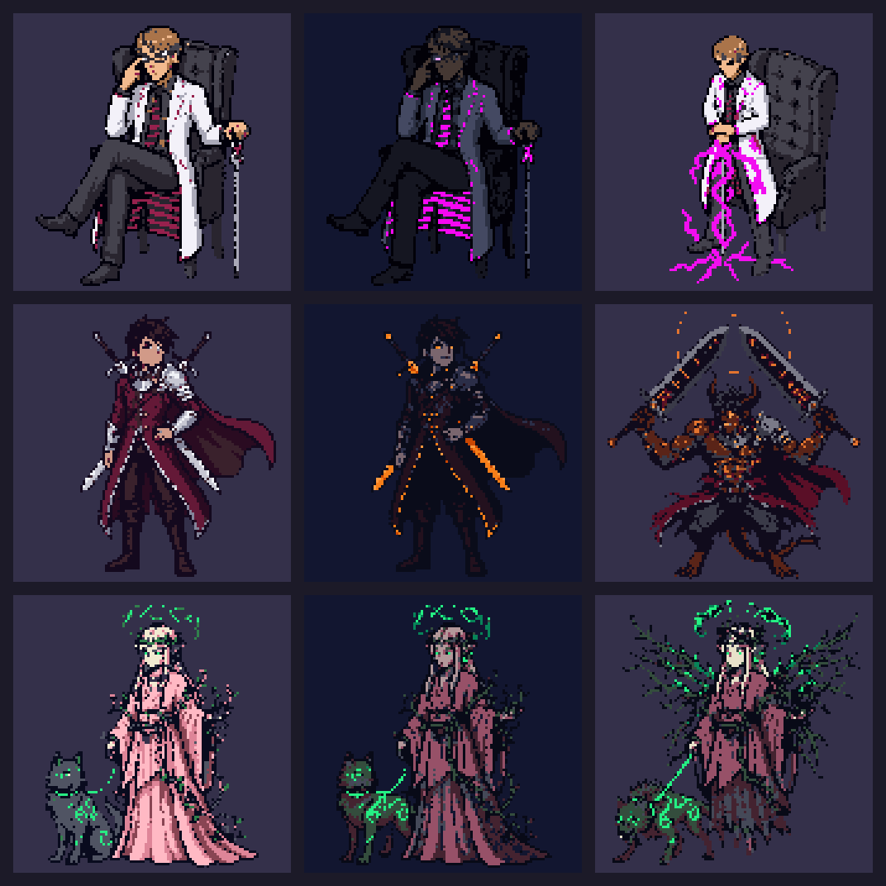
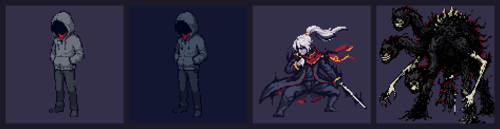
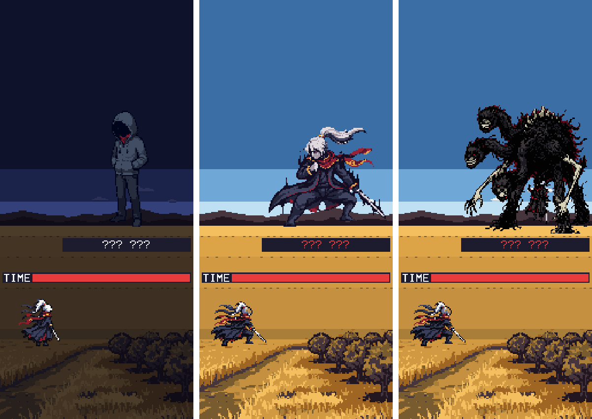

# Boss Rush: Every Deadline Is a Boss Fight

*My entry for the contest **Your Deadline, Your Design: Create a Countdown Lock Screen**.*

Boss Rush turns your iPhone lock screen into a pixel-art boss fight. Each real deadline is a boss. The nearest one stands in front of your hero and transforms as its date gets close; the next ones wait their turn in a column. Every time you pick up your phone, you see what you are up against and how long you have left.



*One lock screen over a season. Left to right: today; QSB two days out (final form, countdown in hours); MATH a day and a half out, at night; BIOE at dawn, with the mysterious `???` waiting behind it.*

## What it does

- **Your deadlines, as a queue of bosses.** The nearest deadline is the boss in front, with its name and a countdown under it. Up to three more wait in the left column, with how many days each has left.
- **Bosses live on your clock.** By day a boss shows its normal (Light) form, at night its Dark form, and in its last three days its Final form, at any hour. In the last two days the countdown switches from days to hours, and the plate turns red.
- **Your hero reacts.** He idles while deadlines are far away and draws his sword when the front boss reaches its final days.
- **A TIME bar and a NEXT line.** The bar drains toward the deadline; the line under the hero names your next preparation step and its date ("NEXT 11/27 SLIDE OUTLINE").
- **The picture is the wallpaper.** Nothing runs on the phone: you plan in the web app, export the picture at your screen's exact size, and set it as your lock screen.

## The bosses

Every boss is an original character designed for one of my courses, with a normal, a night and a final form:



| Course | Boss | Final form |
| --- | --- | --- |
| **QSB 278**, Quantitative and Systems Biology | A cold scientist in a lab coat with zebrafish-stripe lining, seated in a leather armchair, a cane topped with a glass X chromosome | He stands up and turns to face you, the cane crackling with magenta electricity |
| **MATH 227**, differential equations | An elegant duelist in a burgundy coat and light silver armour, two longswords on his back | A horned demon covered in glowing equations, greatswords raised, shock rings like an impulse response |
| **BIOE 240**, bioengineering | A rose-robed deity with an emerald DNA halo and a bound spirit wolf | The deity ascends: branching wings, a brighter halo |

### And then there is `???`

At the back of the line waits a hooded stranger. Its name is `???`, its countdown is `???`, and its TIME bar never drains: the date is real, but the screen never tells you. Only the stranger's transformations tell you it is getting close.

<details>
<summary><b>Spoiler: who is <code>???</code></b></summary>



In its last three days the hood comes down, and it is **you**: the hero's own face with red eyes, in the hero's exact battle stance, mirrored, the two swords parallel. In its last 24 hours the monster inside him bursts out.



The last deadline of every season is the fight with yourself.
</details>

## Made for a real lock screen

- **Laid out around iOS.** The status bar, the clock, the widget row and the flashlight and camera buttons each have a reserved zone; the boss, the plates and the hero are placed between them. Checked on an iPhone running iOS 27.
- **Crisp pixels at any size.** The picture is drawn on a small pixel grid and scaled up by whole numbers only, with no smoothing, to your phone's exact resolution (set it in the Planner).
- **One battlefield.** Boss and hero stand on the same land: the boss far away at the foot of the hills, the hero close by.
- **Four skies.** Dawn, day, dusk and night each recolour the sky, the land and the clouds.
- **Deterministic.** The picture depends only on your plan and the time. The same plan at the same moment always gives the same PNG, down to the byte, which is what lets the app make every picture in advance.

## Try it

You need [Bun](https://bun.sh):

```sh
bun install
bun run dev          # then open http://localhost:5173
```

- **Planner:** enter your deadlines, short names (up to 5 letters) and preparation steps; set your phone's screen size. A short name of `???` keeps a boss's date secret.
- **Preview:** drag the time slider through the season and watch each boss transform (try mid-December).
- **Export:** today's picture at your screen size. On the iPhone: save it to Photos, set it as your lock screen wallpaper and pinch out so it is not zoomed. Also: a pack of five pictures per day (midnight, dawn, day, dusk, night) and a calendar file of your deadlines.

To open it from your phone on the same Wi-Fi, run `bun run dev --host` and use the Network address it prints.

## How it was built

- **TypeScript in a Bun workspace:** `core` (plan, schedule, layout, palette), `render` (scene to pixels to PNG), `web` (Preact app), `tools` (art import).
- **Art.** I worked with Gemini on the web to figure out the design of each boss, one at a time, and to draw the pictures on a flat green background. Our import tool removes the background, snaps the colours to a small palette per form, finds the portrait crop and packs everything into one sprite atlas. To control camera angles, which image models get wrong, the poses were blocked out as 3D box mannequins rendered in code (`art/ref/`) and attached as pose references.
- **Tested:** 259 automated tests, including golden-image tests that compare rendered lock screens pixel for pixel.
- **Code.** Written with AI coding agents in Claude Code and Antigravity, several working in this one repository at the same time from written briefs, with one agent merging and reviewing. I directed the design and tested it on my own phone.

## Known limits

- Tested on one iPhone with iOS 27. The iOS 26 and iPad layouts exist but were not tested on a device.
- The wallpaper is a still picture that you export and set. An automatic swap through the day with Apple Shortcuts is planned but not yet verified on a phone.
- The NEXT line goes by date; it does not know which steps you have finished.
